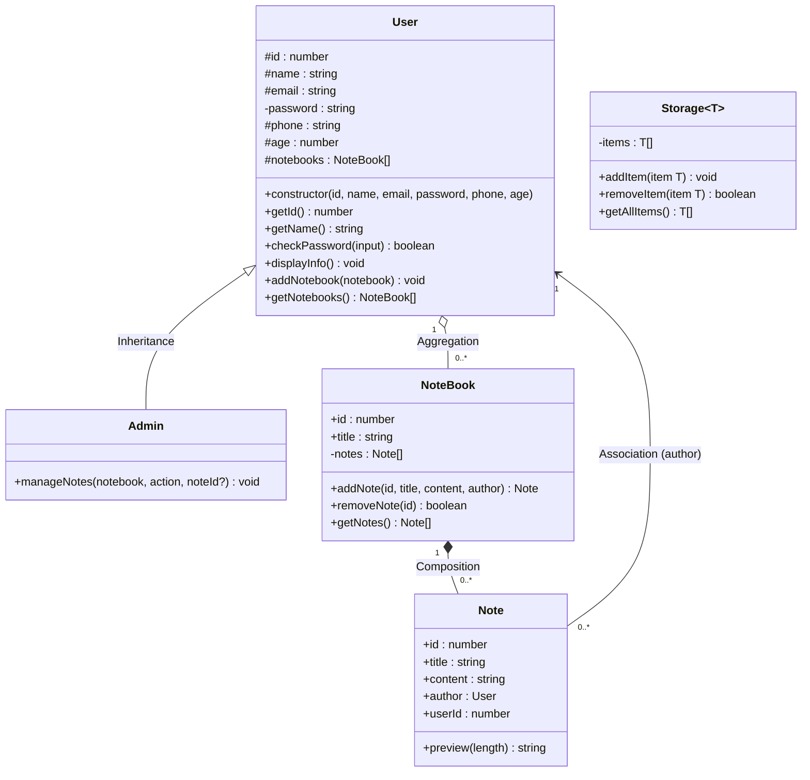

# Part B - UML Class Diagram: Simple Notes Management System

## 1. Class Diagram

Legend: `+` public, `#` protected, `-` private.

## 2. Relationships

| Relationship | Between | UML symbol | Why |
|---|---|---|---|
| Inheritance | Admin → User | Hollow triangle | Admin extends User and inherits its properties and methods |
| Composition | NoteBook ◆— Note | Filled diamond | NoteBook creates and owns its notes; they do not exist without it |
| Aggregation | User ◇— NoteBook | Hollow diamond | A user owns many notebooks, but a notebook is created independently and survives without the user |
| Association | Note → User | Open arrow | Each note refers to the user who authored it |